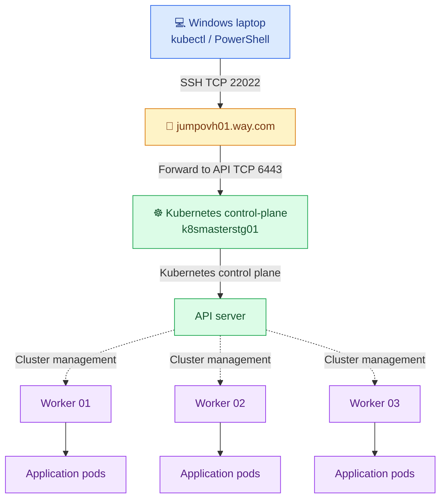
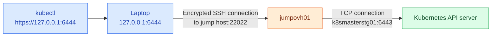
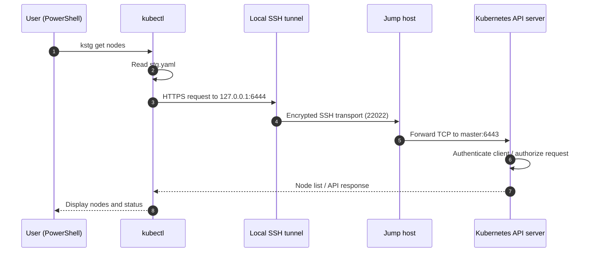
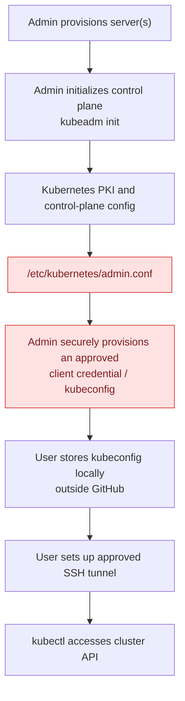
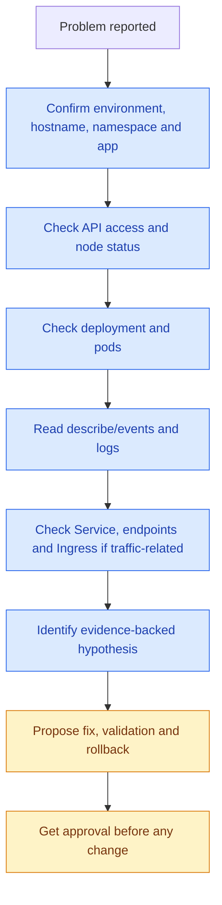

# ☸️ Kubernetes Access, Kubeconfig & Troubleshooting Guide

   

> [!IMPORTANT]
> **Purpose:** Explain how to access our self-managed Kubernetes clusters from Windows, why different ports are used, how kubeconfig is created, how to add another environment, and how to investigate problems safely.
>
> **Scope:** DEV, QA, STG. Examples for a future QAX environment are illustrative, **not confirmed infrastructure**.

## 📚 Contents

1. [The big picture](#-1-the-big-picture)
2. [Our environments](#-2-our-environments)
3. [Why the ports are different](#-3-why-the-ports-are-different)
4. [What happens when you run kubectl](#-4-what-happens-when-you-run-kubectl)
5. [What is a kubeconfig YAML file?](#-5-what-is-a-kubeconfig-yaml-file)
6. [How kubeconfig is created](#-6-how-kubeconfig-is-created)
7. [SSH tunnel setup](#-7-ssh-tunnel-setup)
8. [PowerShell shortcuts](#-8-powershell-shortcuts)
9. [Adding a new environment](#-9-adding-a-new-environment)
10. [Kubernetes YAML vs kubeconfig YAML](#-10-kubernetes-yaml-vs-kubeconfig-yaml)
11. [Read-only troubleshooting commands](#-11-read-only-troubleshooting-commands)
12. [Troubleshooting scenarios](#-12-troubleshooting-scenarios)
13. [Security, permissions and rollback](#-13-security-permissions-and-rollback)
14. [Quick reference](#-14-quick-reference)

---

## 🧭 1. The big picture

### Minikube practice vs company Kubernetes

| Topic | Minikube on an EC2 VM | Company Kubernetes |
|---|---|---|
| Kubernetes cluster | Created by Minikube | Existing multi-node clusters |
| Typical access | SSH to VM → `kubectl` | Windows → SSH tunnel → API server |
| Kubernetes API | Usually managed by Minikube | Exposed internally on a control-plane endpoint |
| Commands | `kubectl get pods` | `kdev get pods` / `kqa get pods` / `kstg get pods` |
| Troubleshooting concepts | Pods, logs, events, services | **The same concepts** |
| Risk | Personal lab | Shared company infrastructure |



**Key distinction:** Your laptop does **not** run the company Kubernetes cluster. It sends API requests to the remote cluster.

---

## 🗂️ 2. Our environments

The following values were verified in our working setup:

| Environment | API master hostname | Laptop port | Remote API port | Kubeconfig | Nodes seen |
|---|---|---:|---:|---|---:|
| 🟢 DEV | `k8smasterdev01` | `6442` | `6443` | `$HOME\.kube\dev.yaml` | 2 |
| 🟡 QA | `k8smasterqa01` | `6443` | `6443` | `$HOME\.kube\qa.yaml` | 4 |
| 🔵 STG | `k8smasterstg01` | `6444` | `6443` | `$HOME\.kube\stg.yaml` | 4 |

**Verified commands:** `kdev get nodes`, `kqa get nodes`, and `kstg get nodes` returned Ready nodes. That confirms access using the tunnels available at the time; it does **not** by itself prove that automatic tunnel startup works when a tunnel is stopped.

> [!NOTE]
> These are access details, not a complete network inventory. Hostnames, cluster topology, and Kubernetes versions can change.

---

## 🔌 3. Why the ports are different

A **port** is a numbered endpoint used by a network service. Think of an IP address as a building address and a port as a specific door.

| Port | Where? | What is it for? |
|---|---|---|
| `22022` | Jump host | SSH login entry point used in this setup |
| `6443` | Kubernetes master | Common default **Kubernetes API server** HTTPS port |
| `6442` | Your Windows laptop | Chosen **local** listening port for DEV |
| `6443` | Your Windows laptop | Chosen **local** listening port for QA |
| `6444` | Your Windows laptop | Chosen **local** listening port for STG |

> [!TIP]
> **Local 6443 and remote 6443 are different sockets on different machines.** They can share the same number without conflicting. You could choose a different unused local port; the remote port must match the actual API endpoint.

### STG example: `6444` → `6443`



**Read the SSH forwarding expression:**

```text
-L 127.0.0.1:6444:k8smasterstg01:6443
   └── laptop ──┘ └── destination ──┘
```

- `-L`: create a **local** TCP forward.
- `127.0.0.1`: listen on the laptop only, not all network interfaces.
- `6444`: local port chosen for STG.
- `k8smasterstg01`: target host reachable **from the jump host**.
- `6443`: Kubernetes API server port **on the target**.
- `-p 22022`: SSH server port **on the jump host**; it is not the Kubernetes port.
- `-N`: don't run a remote shell/command; use SSH for forwarding.
- `-f`: request backgrounding; support varies by Windows OpenSSH version.
- `-T`: disable pseudo-terminal allocation.

**Important:** This forwards Kubernetes API requests, **not** browser traffic to application pods. Application access may follow a different ingress/load-balancer path.

---

## 🔄 4. What happens when you run kubectl



`kubectl` is a **client**. The API server decides whether the authenticated identity may perform the requested action. The SSH tunnel only provides network connectivity; it does not grant Kubernetes permissions.

---

## 📄 5. What is a kubeconfig YAML file?

A kubeconfig tells `kubectl` **where to connect**, **who to authenticate as**, and **which connection to use by default**.

See [`examples/kubeconfig-example.yaml`](examples/kubeconfig-example.yaml).

```yaml
apiVersion: v1
kind: Config
clusters:
  - name: staging-cluster
    cluster:
      server: https://127.0.0.1:6444
      certificate-authority-data: <BASE64_CA_CERTIFICATE>
users:
  - name: staging-reader
    user:
      client-certificate-data: <BASE64_CLIENT_CERTIFICATE>
      client-key-data: <BASE64_CLIENT_PRIVATE_KEY>
contexts:
  - name: staging-reader@staging-cluster
    context:
      cluster: staging-cluster
      user: staging-reader
current-context: staging-reader@staging-cluster
```

| Field | Simple meaning |
|---|---|
| `clusters[].cluster.server` | Where `kubectl` sends API requests |
| `certificate-authority-data` | Trusted CA for verifying the API server certificate |
| `users[].user.client-certificate-data` | Client identity certificate |
| `users[].user.client-key-data` | **Private key** proving the client identity |
| `contexts` | Links a cluster and user, optionally a namespace |
| `current-context` | Default connection selected by kubectl |

> [!CAUTION]
> Your previously supplied STG kubeconfig contained `client-key-data` and `insecure-skip-tls-verify: true`. **Never commit the real file or key to GitHub.** Base64 is **not encryption**. Treat any shared cluster-admin key as exposed and coordinate revocation/reissuance with the cluster administrator. Prefer a dedicated least-privilege identity and a trusted CA. The examples here intentionally contain **no real credentials**.

### Why `127.0.0.1`?

It means **this laptop**. `kubectl` connects to the tunnel's local listening port; SSH then transports the request to the remote API server.

### Why not use `insecure-skip-tls-verify: true`?

That setting disables verification of the API server's TLS certificate. It may have been used to work around certificate name/CA issues, but it weakens security. A trusted CA and an endpoint/certificate arrangement approved by the cluster administrator are preferable. Do not change TLS settings blindly: confirm the certificate's names and trust chain first.

---

## 🏗️ 6. How kubeconfig is created

### A. Cluster initialization: what happens on a new self-managed cluster?

For a cluster built with `kubeadm`, an authorized administrator typically initializes the control plane using `kubeadm init` **as part of a planned provisioning procedure**. During that process, kubeadm creates control-plane configuration and certificates, and usually creates an administrative kubeconfig at:

```text
/etc/kubernetes/admin.conf
```



**Do not run `kubeadm init` on an existing company cluster.** It is a cluster provisioning operation, not a way to generate a personal kubeconfig.

### B. Where does the YAML come from?

A kubeconfig is a normal YAML document following Kubernetes' `Config` format. It can be produced by provisioning tools, Kubernetes administrators, or `kubectl config` commands. **Your exact file's origin cannot be proven from its contents alone.**

Common possibilities:

1. The admin used an existing kubeadm-generated admin config as the starting point.
2. The admin provisioned a **separate client certificate and key**, with appropriate permissions, then assembled a kubeconfig.
3. An identity provider or access platform generated a kubeconfig using a token or credential plugin instead of embedded client keys.

**Recommended for company access:** Request a dedicated user/service identity with RBAC permissions appropriate for troubleshooting, rather than copying cluster-admin credentials to every engineer.

### C. How can an admin assemble a kubeconfig?

Below is an **illustrative** process for an already-authorized, separately provisioned client identity. It assumes an administrator has already securely generated a suitable CA, client certificate, and client private key. **Do not generate credentials or run these steps against company systems without an approved access process.**

```bash
# Example only; run on an approved admin workstation.
# Create an empty client config file in a protected location.
kubectl config set-cluster staging-cluster \
  --server=https://127.0.0.1:6444 \
  --certificate-authority=/secure/path/ca.crt \
  --embed-certs=true \
  --kubeconfig=stg-client.yaml
```

```bash
kubectl config set-credentials staging-reader \
  --client-certificate=/secure/path/staging-reader.crt \
  --client-key=/secure/path/staging-reader.key \
  --embed-certs=true \
  --kubeconfig=stg-client.yaml
```

```bash
kubectl config set-context staging-reader@staging-cluster \
  --cluster=staging-cluster \
  --user=staging-reader \
  --kubeconfig=stg-client.yaml
```

```bash
kubectl config use-context staging-reader@staging-cluster \
  --kubeconfig=stg-client.yaml
```

The CA, certificate and private key **must match** the actual cluster and identity. `set-credentials` does **not** issue a certificate or grant permissions. Kubernetes RBAC must be configured separately by an administrator.

> [!NOTE]
> If the server certificate is valid only for a different DNS name than `127.0.0.1`, the administrator must provide an approved certificate-validating configuration (for example, a suitable `tls-server-name` and CA) rather than disabling verification.

---

## 🔐 7. SSH tunnel setup

**Execution context:** Windows PowerShell on your laptop. These are connectivity commands, not Kubernetes changes.

### STG (one foreground tunnel)

```powershell
ssh -p 22022 -N -L 127.0.0.1:6444:k8smasterstg01:6443 hariprabhu@jumpovh01.way.com
```

The terminal stays occupied while the tunnel is active. Open **another PowerShell tab** for `kubectl`:

```powershell
kubectl --kubeconfig="$HOME\.kube\stg.yaml" get nodes
```

### DEV and QA

```powershell
ssh -p 22022 -N -L 127.0.0.1:6442:k8smasterdev01:6443 hariprabhu@jumpovh01.way.com
```

```powershell
ssh -p 22022 -N -L 127.0.0.1:6443:k8smasterqa01:6443 hariprabhu@jumpovh01.way.com
```

> [!TIP]
> Use **one tunnel per environment**. Each local listening port must be unused. If an existing tunnel already occupies the port, do not start another one on the same port.

### Read-only port check (Windows PowerShell)

```powershell
Get-NetTCPConnection -LocalAddress 127.0.0.1 -LocalPort 6444 -State Listen -ErrorAction SilentlyContinue
```

- ✅ A listener exists: **something** is listening; inspect its owning process before assuming it is the correct SSH tunnel.
- ❌ No listener: the local STG tunnel may not be running.

```powershell
Get-NetTCPConnection -LocalAddress 127.0.0.1 -LocalPort 6444 -State Listen -ErrorAction SilentlyContinue | Select-Object LocalAddress,LocalPort,OwningProcess
```

Do not kill processes based on a port number alone.

---

## ⚡ 8. PowerShell shortcuts

Your PowerShell profile is:

```text
C:\Users\Way_Admin\Documents\WindowsPowerShell\Microsoft.PowerShell_profile.ps1
```

The existing shortcuts invoke `kubectl` with environment-specific kubeconfigs and check/start tunnels:

| Shortcut | What it means |
|---|---|
| `kdev get nodes` | Run `kubectl get nodes` using DEV config |
| `kqa get pods -A` | List all QA pods |
| `kstg get deployments -A` | List STG deployments |

The current profile uses `Start-KubeTunnel` to check local port ownership and launch SSH with `-fNT` when no listener is found. **The shortcuts have been verified while tunnels were available; automatic startup after tunnel shutdown still needs a separate test.** Windows OpenSSH support for backgrounding should also be validated on your laptop.

### Load profile after a change

```powershell
. $PROFILE
```

### Read current profile without exposing kubeconfig secrets

```powershell
Get-Content $PROFILE
```

> [!WARNING]
> Do not paste kubeconfig content, certificates, private keys, or secret environment variables into tickets or GitHub issues.

---

## ➕ 9. Adding a new environment

Example: a future **QAX** cluster. **Everything in this section is a template** until the infrastructure team confirms actual details.

### Phase 1 — Collect details before running commands

| Item to confirm | Example only |
|---|---|
| Environment | QAX |
| API master / endpoint | `k8smasterqax01` (unconfirmed) |
| API port | `6443` (verify) |
| Jump host | `jumpovh01.way.com` (verify routing) |
| Jump SSH port | `22022` (verify) |
| Local laptop port | `6445` (check unused) |
| Kubeconfig | `$HOME\.kube\qax.yaml` |
| Client identity | Dedicated, least-privilege account |
| CA and TLS server name | Provided/approved by admin |
| Permissions | Read-only or approved role |

### Phase 2 — Request the access package

Ask the Kubernetes administrator for a **securely delivered** kubeconfig (or identity-provider instructions), API endpoint, approved jump route, and required RBAC permissions. Do not request private keys in email or GitHub.

### Phase 3 — Verify local port is free

**Windows PowerShell:**

```powershell
Get-NetTCPConnection -LocalAddress 127.0.0.1 -LocalPort 6445 -State Listen -ErrorAction SilentlyContinue
```

Expected: no output if unused. If output exists, investigate; do not overwrite or stop the listener.

### Phase 4 — Save the approved kubeconfig

Place the credential file at the approved protected path (example: `$HOME\.kube\qax.yaml`). Ensure its `server` points to the local tunnel endpoint `https://127.0.0.1:6445` and its CA/TLS identity settings remain valid. The administrator should approve any changes to the issued file.

**Verify only the server address, without displaying secrets:**

```powershell
kubectl --kubeconfig="$HOME\.kube\qax.yaml" config view --minify -o jsonpath='{.clusters[0].cluster.server}'
```

Expected: `https://127.0.0.1:6445`.

### Phase 5 — Start the tunnel (example, foreground)

**Windows PowerShell, first tab:**

```powershell
ssh -p 22022 -N -L 127.0.0.1:6445:k8smasterqax01:6443 hariprabhu@jumpovh01.way.com
```

**Only after the infrastructure team confirms that hostname and port.**

### Phase 6 — Test the cluster

**Windows PowerShell, second tab:**

```powershell
kubectl --kubeconfig="$HOME\.kube\qax.yaml" get nodes
```

- ✅ Nodes appear: connectivity, authentication and authorization for `get nodes` are working.
- ❌ Connection refused: check local tunnel listener.
- ❌ Timeout: investigate SSH route / remote API connectivity.
- ❌ Unauthorized: check credentials and identity.
- ❌ Forbidden: check RBAC authorization.
- ❌ TLS error: check CA, certificate names and validity; do not disable verification as a shortcut.

### Phase 7 — Add a shortcut (after verification)

**Example function for the PowerShell profile:**

```powershell
function kqax {
    Start-KubeTunnel -Port 6445 -Master "k8smasterqax01"
    kubectl --kubeconfig="$HOME\.kube\qax.yaml" @args
}
```

**Before editing:** back up the profile, review the existing helper, and confirm the chosen port and host. The existing helper should be reviewed to ensure a tunnel-start failure prevents `kubectl` from running. Add this function only after approved access and a successful manual tunnel test.

---

## 🧩 10. Kubernetes YAML vs kubeconfig YAML

These are **two different kinds of YAML**.

| File | Purpose | Used by |
|---|---|---|
| `kubeconfig-example.yaml` | Connection details + authentication | `kubectl --kubeconfig=...` |
| `deployment-example.yaml` | Desired application pod configuration | `kubectl apply -f ...` |
| `service-example.yaml` | Stable internal network address for pods | Kubernetes Service controller |

### Example Deployment YAML

See [`examples/deployment-example.yaml`](examples/deployment-example.yaml).

```yaml
apiVersion: apps/v1
kind: Deployment
metadata:
  name: demo-web
  namespace: demo
spec:
  replicas: 2
  selector:
    matchLabels:
      app: demo-web
  template:
    metadata:
      labels:
        app: demo-web
    spec:
      containers:
        - name: web
          image: nginx:1.27
          ports:
            - containerPort: 80
```

**Meaning:** Ask Kubernetes to maintain two nginx pods in the `demo` namespace. The namespace must already exist. `containerPort: 80` documents the container's listening port; it does **not** expose the app on your laptop or open a firewall port.

### Example Service YAML

See [`examples/service-example.yaml`](examples/service-example.yaml).

```yaml
apiVersion: v1
kind: Service
metadata:
  name: demo-web
  namespace: demo
spec:
  type: ClusterIP
  selector:
    app: demo-web
  ports:
    - port: 80
      targetPort: 80
```

**Meaning:** Create an internal Kubernetes Service that routes to pods with label `app: demo-web`. It is **not** a public website by itself. An Ingress or other approved routing component may be required for external access.

> [!CAUTION]
> These are **learning examples**, not approved company manifests. **Do not run `kubectl apply`, `delete`, `rollout restart`, `scale`, or edit live resources without approval, validation, and a rollback plan.**

---

## 🔍 11. Read-only troubleshooting commands

Run on **Windows PowerShell**. Use `kdev`, `kqa`, or `kstg` depending on the intended environment.

| Question | Read-only command | What to inspect |
|---|---|---|
| Is the cluster reachable? | `kdev cluster-info` | API endpoint reachable |
| Are nodes healthy? | `kdev get nodes -o wide` | `Ready`, roles, node addresses |
| Which namespaces exist? | `kdev get namespaces` | Namespace names |
| What pods are running? | `kdev get pods -A` | `Running`, `Pending`, `CrashLoopBackOff` |
| What is deployed? | `kdev get deployments -A` | Desired vs available replicas |
| What services exist? | `kdev get svc -A` | Service ports and types |
| What ingress exists? | `kdev get ingress -A` | Hosts and backends |
| What events occurred? | `kdev get events -A --sort-by=.lastTimestamp` | Recent warnings and scheduling issues |
| Why is a pod failing? | `kdev describe pod POD_NAME -n NAMESPACE` | Conditions, events, probes |
| What do app logs say? | `kdev logs POD_NAME -n NAMESPACE --tail=100` | Startup errors / exceptions |
| Is a rollout healthy? | `kdev rollout status deployment/NAME -n NAMESPACE --timeout=10s` | Deployment readiness (read-only observation) |
| What permissions do I have? | `kdev auth can-i get pods -n NAMESPACE` | RBAC yes/no |

Replace placeholders only after confirming the real namespace and resource name. Some `get` operations can be forbidden to a limited account; that is not necessarily a cluster outage.

### Recommended investigation order



---

## 🧯 12. Troubleshooting scenarios

Use **Scenario → Hypothesis → Check → Fix**. Do **one command at a time** and review its output before continuing.

### Scenario A — `connection refused` on `127.0.0.1:6444`

- **Scenario:** `kstg get nodes` cannot reach the local endpoint.
- **Hypothesis:** The STG SSH tunnel is not listening, or a wrong process owns the port.
- **Check — Windows PowerShell:**

```powershell
Get-NetTCPConnection -LocalAddress 127.0.0.1 -LocalPort 6444 -State Listen -ErrorAction SilentlyContinue
```

- **Interpretation:** No listener suggests no active local tunnel. A listener alone does not prove the tunnel points to STG.
- **Fix (only after verification):** Re-establish the approved tunnel; check SSH error output and confirm destination before retrying `kstg get nodes`.

### Scenario B — `Forbidden` response

- **Scenario:** API connection works but a command is denied.
- **Hypothesis:** Kubernetes RBAC does not permit the action.
- **Check — Windows PowerShell:**

```powershell
kdev auth can-i list pods --all-namespaces
```

- **Interpretation:** `no` means the authenticated identity lacks that permission. **Do not** bypass permissions by switching to shared admin credentials; request approved access.

### Scenario C — `CrashLoopBackOff`

- **Scenario:** Application pod restarts repeatedly.
- **Hypotheses:** Application startup error, missing configuration, failing health check, or resource constraints.
- **First check — Windows PowerShell:**

```powershell
kdev get pods -n NAMESPACE
```

- **Next checks after identifying the pod:** `kdev describe pod POD_NAME -n NAMESPACE`, then `kdev logs POD_NAME -n NAMESPACE --previous --tail=100` when previous logs exist.
- **Fix:** Determine cause from logs/events before proposing a deployment/config change. Approval and rollback required.

### Scenario D — Pod stuck `Pending`

- **Scenario:** Pod is not scheduled or not started.
- **Hypotheses:** Insufficient resources, scheduling constraints, volume problems, or image pull issues.
- **First check — Windows PowerShell:**

```powershell
kdev describe pod POD_NAME -n NAMESPACE
```

- **Interpretation:** Check `Events` for `FailedScheduling`, volume errors or other messages. Don't assume resource shortage without evidence.

### Scenario E — Application URL returns 502/503

- **Scenario:** Browser/API URL fails, but Kubernetes API access works.
- **Hypotheses:** Ingress/gateway issue, Service has no ready endpoints, pods not ready, or an upstream outside Kubernetes is failing.
- **First check — Windows PowerShell:**

```powershell
kdev get ingress -A
```

- **Next checks:** Confirm the actual ingress hostname, namespace, service, EndpointSlices, pod readiness, and upstream reverse proxy configuration. **Do not assume** the URL is routed through Kubernetes until the traffic path is verified.
- **HTTP check:** `curl.exe -ik https://APP_HOST/PATH` from the approved machine/network, once the real URL is confirmed.

### Scenario F — TLS verification failure

- **Scenario:** `x509` certificate error when accessing Kubernetes API.
- **Hypotheses:** Incorrect CA, expired cert, or server name mismatch due to loopback endpoint.
- **First check — Windows PowerShell:**

```powershell
kubectl --kubeconfig="$HOME\.kube\stg.yaml" config view --minify -o jsonpath='{.clusters[0].cluster.server}'
```

- **Next:** Ask the administrator to inspect certificate trust and endpoint name. Do not disable TLS verification as a quick fix.

---

## 🛡️ 13. Security, permissions and rollback

> [!CAUTION]
> **Never put these into a GitHub repository:** real `*.yaml` kubeconfigs with embedded credentials, `admin.conf`, `client-key-data`, SSH private keys, access tokens, `.env` secrets, or terminal output containing them.

- Keep real kubeconfigs outside the repository, under a protected user directory.
- Use approved least-privilege Kubernetes identities and RBAC.
- Use certificate validation; do not silently accept `insecure-skip-tls-verify`.
- SSH tunnel encryption protects the laptop-to-jump connection; verify how the jump host reaches the API server and ensure Kubernetes API TLS is properly validated.
- For troubleshooting, start with **read-only** status/logs/events.
- For changes to a deployment, networking, certificates, RBAC, kubeconfig or PowerShell profile: **verify first**, take an appropriate backup or record previous state, request approval, then test and document rollback.
- Before changing your PowerShell profile, keep a backup and test a manual tunnel independently.
- If a client key has been exposed, coordinate certificate revocation/rotation and reissue with the administrator. Merely deleting the pasted text does not invalidate the credential.

### Example `.gitignore`

See [`.gitignore`](.gitignore). The example excludes common private config/key locations while keeping the intentionally sanitized examples available for GitHub.

---

## 🧾 14. Quick reference

```text
Windows PowerShell
  kdev get nodes              → DEV node status
  kqa get pods -A             → QA pods across namespaces
  kstg get deployments -A     → STG deployments

Network path
  Laptop local port 6442 → DEV API master port 6443
  Laptop local port 6443 → QA API master port 6443
  Laptop local port 6444 → STG API master port 6443
  All via jumpovh01 SSH port 22022

Files
  ~/.kube/dev.yaml            → DEV client connection settings (private)
  ~/.kube/qa.yaml             → QA client connection settings (private)
  ~/.kube/stg.yaml            → STG client connection settings (private)
  README.md                   → Public/sanitized documentation
  examples/*.yaml            → Placeholder examples only
```

### Final mental model

**`kubectl` = remote control** · **kubeconfig = address + identity** · **SSH tunnel = secure network path** · **API server = Kubernetes entry point** · **RBAC = permissions** · **pods = where applications run**.

---

*Maintainer note: Update the environment table and access examples when infrastructure changes. Never add secrets to documentation.*
